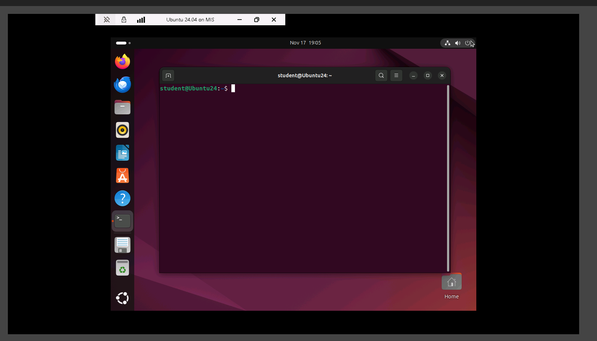
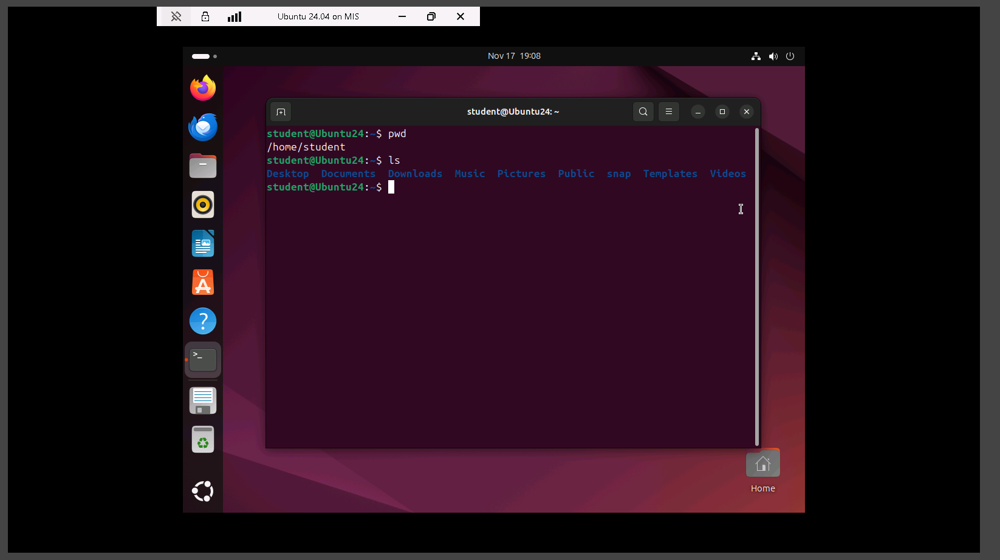
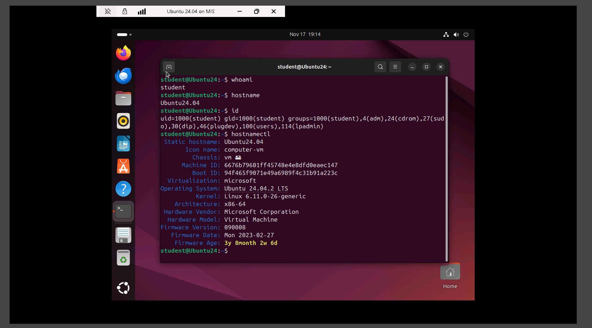

# Lab 01: System Navigation and Identity

**Network Applications | Solent University**

## 🎯 Objective

Learn to navigate the Linux Server file system using the Bash shell, identify the current user and hostname, and understand basic system information.

## 🧪 Lab Implementation

### Step 1: Access the Linux Terminal

Inside the Ubuntu Server virtual machine:

1. Start the virtual machine using Hyper-V Manager.
2. Log in using your username and password.
3. Access the command-line interface (CLI).

Unlike Windows Server with Desktop Experience, Ubuntu Server provides a command-line interface by default, allowing administrators to interact directly with the operating system through the shell.



### Step 2: Understanding Your Location

1. **Print Working Directory Command** `pwd` — Where am I?
   - The `pwd` command displays the absolute path of the current working directory.

Output:
```text
/home/student
```

Currently inside the student user's home directory.

Unlike Windows, Linux does not organise its file system using drive letters such as `C:`. Instead, all directories originate from a single root directory represented by `/`.

⚠️ Always know your location before creating or modifying files.

2. **Directory Listing Command** `ls` — What is inside this directory?
   - The `ls` command is used to list files and subdirectories.
   - When executed without arguments, it displays the contents of the current working directory, excluding hidden files by default.

```bash
ls
ls -l
ls -la
```

- `ls` — Lists files and directories.
- `ls -l` — Displays detailed information, including permissions, ownership, sizes and modification dates.
- `ls -la` — Displays detailed information about all files, including hidden files.



⚠️ Always check the contents of a directory before modifying or deleting files.

3. **Navigating Between Directories**

   - `cd /etc` — Moves into the system configuration directory.
   - `cd ..` — Moves one level up to the parent directory.
   - `cd /` — Moves to the root directory.
   - `cd ~` — Moves to the current user's home directory.
   - `cd /home/admin` — Moves directly to the specified directory using its absolute path.
   - `cd -` — Returns to the previous working directory.


> NOTE: `clear` - Clears the command-line screen 

### Step 3: System Identity

Before performing administrative tasks, it is important to identify the current user account and the server we are working on.

1. **Current User Command** `whoami` — Who am I?
   - The `whoami` command displays the username associated with the current effective user identity.

Output:
```text
student
```

⚠️ Different users have different permissions. The root user has unrestricted administrative privileges.

2. **Hostname Command** `hostname` — Which computer am I working on?
   - The `hostname` command displays the name of the server.
   - It helps administrators identify the system they are accessing, particularly in environments with multiple servers.

Output:
```text
Ubuntu24.04
```

3. **User Identity Command** `id` — What is my user and group identity?
   - The `id` command displays the user's identification number (UID), primary group identification number (GID) and group memberships.

4. **System Information Command** `hostnamectl` — What system am I working on?
   - The `hostnamectl` command displays system information, including the hostname, operating system, kernel version and architecture.



⚠️ Always verify your user identity and hostname before performing administrative tasks. Working on the wrong server or using the wrong account can lead to unintended changes.

## 🧰 Tools Used
- Linux Terminal (Bash Shell)
- University Learning on Demand (LOD) Platform
- Hyper-V Manager
- Ubuntu Server

## 🔐 Security Relevance
- **User Identity:** Identifying the current user helps administrators understand which account is being used to perform tasks.
- **System Identification:** Verifying the hostname reduces the risk of making changes on the wrong server.
- **Safe File Management:** Checking the current directory and its contents helps prevent accidental modification or deletion of files.
- **File Permissions:** Understanding file ownership and permissions helps prevent unauthorised access to system resources.
- **Least Privilege:** Administrative tasks should be performed using only the permissions necessary to complete them, avoiding unnecessary use of the root account.

## 📌 Lessons Learned
- How to access and use the Bash shell in Linux Server.
- How to identify the current working directory and list its contents.
- How to navigate the Linux file system using relative and absolute paths.
- How to identify the current user account, group memberships and hostname.
- How to retrieve basic operating system information.
- The importance of verifying system identity and directory location before performing administrative tasks.
