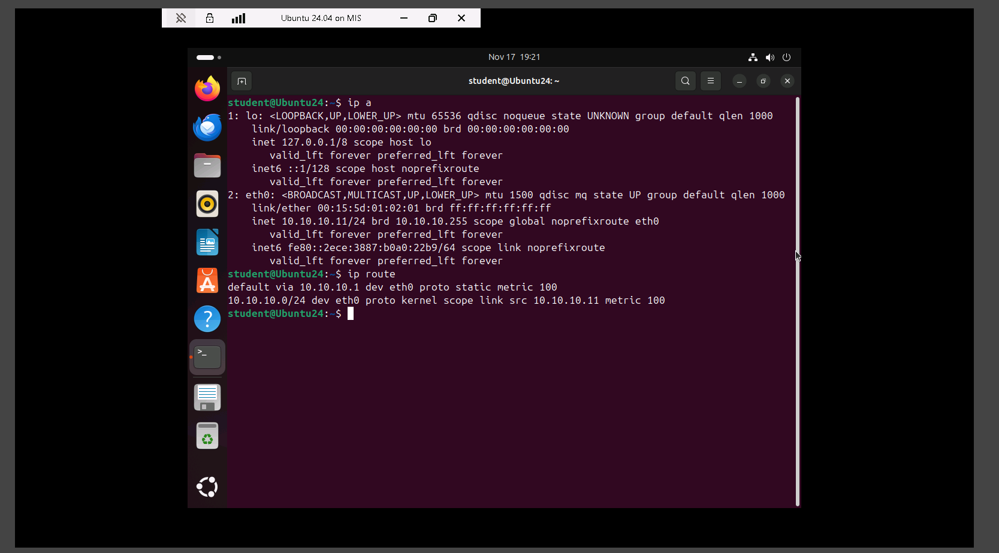
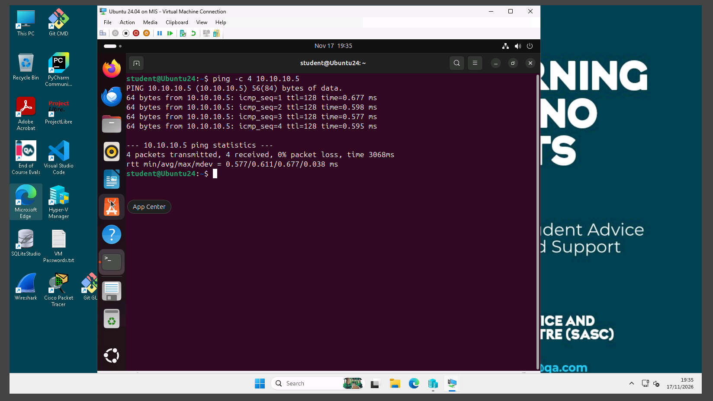

# Lab 02: Network Connectivity

**Network Applications | Solent University**

## 🎯 Objective

Learn to identify network configuration, test connectivity between computers a using the Bash shell in Linux Server.

## 🧪 Lab Implementation

### Step 1: Check Network Configuration

Before testing network connectivity, it is important to understand the current network configuration of the server.

1. **IP Address Command** `ip a` — What is my network configuration?
   - The `ip a` command displays network interfaces and their associated IP addresses.
   - It provides information about IPv4 addresses, IPv6 addresses, MAC addresses and interface status.

Alternatively, use `ip addr` or `ip address`.

2. **IP Routing Command** `ip route` — What is my default gateway?
   - The `ip route` command displays the routing table of the server.
   - It identifies the default gateway and available network routes.



**Understanding the output:**

| Network Component | Description |
|---|---|
| Network Interface | A physical or virtual network interface, such as `eth0` or `ens33`. |
| inet | Represents the IPv4 address assigned to an interface. |
| inet6 | Represents the IPv6 address assigned to an interface. |
| Prefix Length | Defines the network portion of an IP address, such as `/24`. |
| Default Gateway | Usually the router that allows the device to communicate with other networks. |
| link/ether | Represents the MAC address of an Ethernet network interface. |
| DNS Server | Resolves domain names into IP addresses. |
| lo | The loopback interface used for internal network communication. |

Unlike Windows, Linux networking commands typically display the subnet mask using **Classless Inter-Domain Routing (CIDR)** notation.

For example:

```text
10.10.10.11/24
```

The `/24` prefix length corresponds to the subnet mask `255.255.255.0`.

⚠️ Always verify the IP address, subnet prefix and default gateway before troubleshooting network connectivity.

### Step 2: Test Network Connectivity

In this step, we test network communication between Linux Server and Windows Server using the ping command.

1. Identify the Windows Server IP Address.
   - Open Hyper-V Manager.
   - Start the **Windows Server 2025 virtual machine**.
   - Open Command Prompt (CMD).
   - Run the following command to identify its IP address:

```cmd
ipconfig
```
   - Output: 10.10.10.5

Identify the IPv4 address assigned to the appropriate network adapter.

2. **Packet Internet Groper Command** `ping` — Can I reach another device?
   - The `ping` command tests whether another network device responds to ICMP echo requests.
   - It displays response times and packet loss statistics.

Return to the Linux Server terminal and execute:

```bash
ping -c 4 10.10.10.5
```

The `-c 4` option instructs Linux to send four ICMP echo requests before stopping.

Unlike Windows, the Linux `ping` command runs continuously by default. Press **Ctrl+C** to stop it manually.



⚠️ An unsuccessful ping does not necessarily mean a device is offline. Firewall rules may block ICMP traffic.

## 🧰 Tools Used

- Linux Terminal (Bash Shell)
- University Learning on Demand (LOD) Platform
- Hyper-V Manager
- Linux Server Ubuntu 24.04
- Windows Server 2025

## 🔐 Security Relevance

- **Network Identification:** Understanding IP configuration helps administrators identify network interfaces and configuration problems.
- **Network Monitoring:** Connectivity testing helps detect communication failures and service disruptions.
- **Firewall Configuration:** Firewalls can restrict network traffic, including ICMP requests.
- **Network Troubleshooting:** Understanding routing tables helps administrators identify incorrect network routes and gateway configurations.

## 📌 Lessons Learned

- How to identify the network configuration of Linux Server.
- How to identify network interfaces, IP addresses, MAC addresses and subnet prefixes.
- How to understand basic CIDR notation.
- How to identify the default gateway and DNS servers.
- How to test network connectivity using the `ping` command.
- How to interpret connectivity test results.
- How to test network communication between Linux and Windows servers.
