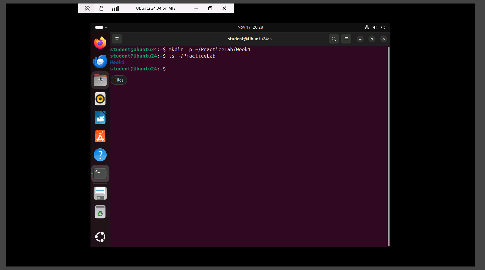
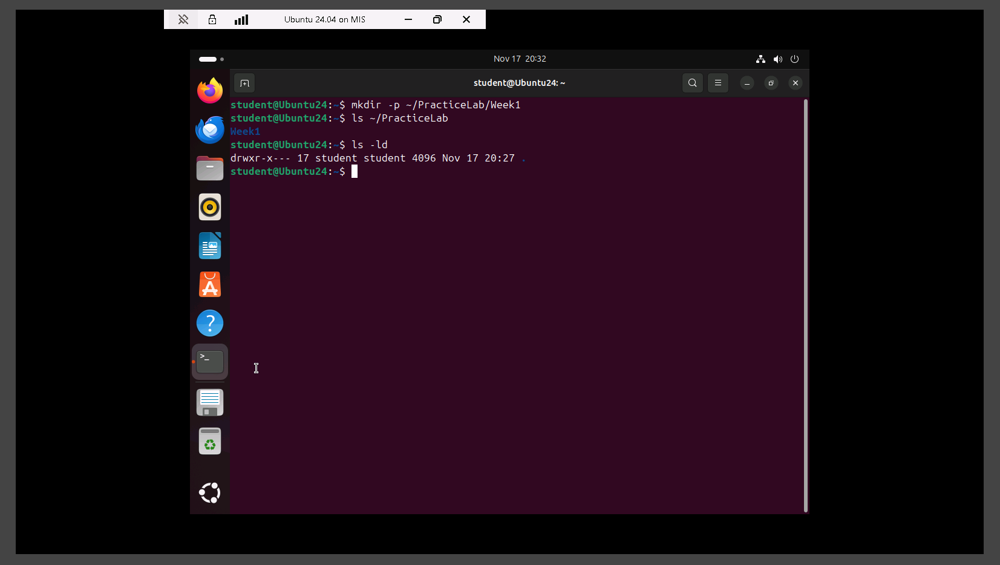
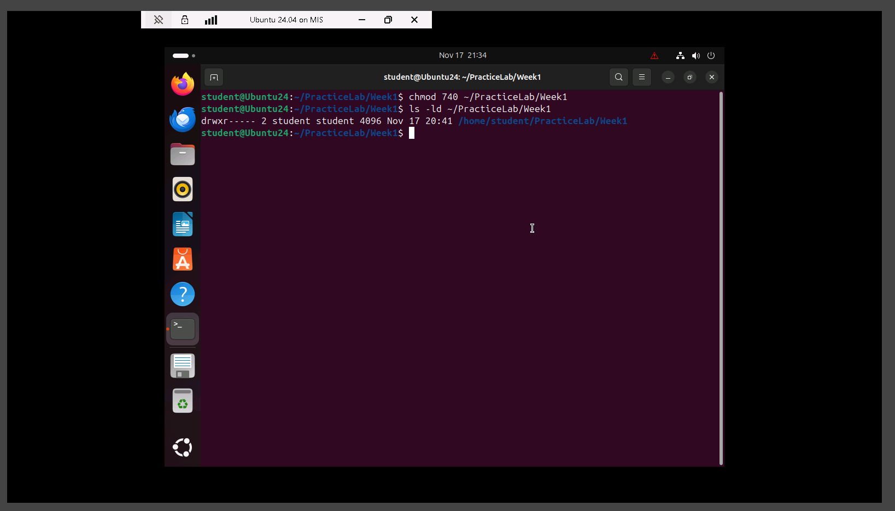

# Lab 03: Exploring File Systems and Permissions

**Network Applications | Solent University**

## 🎯 Objective

Learn to create directories in Linux Server, examine file system permissions and understand how access to files and directories is controlled.

## 🧪 Lab Implementation

### Step 1: Create a Directory

1. Access the Linux terminal.
2. Create a practice directory inside the current user's home directory.

**Make Directory Command** `mkdir` — How do I create a directory?

- The `mkdir` command is used to create new directories.
- The `-p` option allows parent directories to be created automatically if they do not already exist.

```bash
mkdir -p ~/PracticeLab/Week1
```

The `~` symbol represents the current user's home directory.

Verify that the directories have been created:

```bash
ls ~/PracticeLab
```



### Step 2: View Directory Permissions

**List Directory Permissions Command** `ls -ld` — Who can access this directory?

- The `-l` option displays detailed information, including permissions, ownership and group ownership.
- The `-d` option displays information about the directory itself rather than its contents.

```bash
ls -ld ~/PracticeLab
ls -ld ~/PracticeLab/Week1
```



Linux permissions are divided into three categories:

| Category | Description |
|---|---|
| Owner (u) | The user who owns the file or directory. |
| Group (g) | Users belonging to the assigned group. |
| Others (o) | All other users on the system. |

**Understanding the permissions:**

| Permission | Symbol | File | Directory |
|---|---|---|---|
| Read | r | View file contents. | List directory entries. |
| Write | w | Modify file contents. | Create or delete entries, with execute permission. |
| Execute | x | Execute a file. | Access and traverse a directory. |
| No permission | - | Permission not granted. | Permission not granted. |

The permission string `drwxr-x---` can be divided into four sections:

| Section | Description |
|---|---|
| d | Identifies the object as a directory. |
| rwx | Owner has read, write and execute permissions. |
| r-x | Group has read and execute permissions. |
| --- | Others have read and execute permissions. |

⚠️ Always examine existing permissions and ownership before making changes.

### Step 3: Understand Default Permissions

Unlike Windows NTFS, standard Linux permissions are not automatically inherited from the parent directory in the same way.

Linux uses a permission mask called `umask` to determine which permission bits are removed when new files and directories are created, unless a default ACL applies.

1. **User File Creation Mask Command** `umask` — What permissions are removed by default?

**Output:**
```text
0002
```

With a `umask` of `0002`, newly created directories and regular files normally receive the following permissions:

| Object | Base Permissions | Numeric Permission |
|---|---|---|
| Directory | 777 (rwxrwxrwx) | 775 (rwxrwxr-x) |
| File | 666 (rw-rw-rw-) | 664 (rw-rw-r--) |

- This configuration allows both the owner and group to have write permissions, while other users are restricted from writing.
- This is particularly useful in collaborative environments where users belonging to the same group need to modify shared resources.

2. Create a Test File
Create an empty file inside the Week1 directory using the touch command.

```bash
touch ~/PracticeLab/Week1/test.txt
```

3. Examine Default Permissions

```bash
ls -l ~/PracticeLab/Week1
```


Regular files are not normally created with execute permissions by default.

Linux also supports Default Access Control Lists (ACLs), which allow newly created files and subdirectories to inherit access control settings from their parent directory.

⚠️ The umask affects newly created files and directories, not existing ones. Actual permissions may vary depending on ACLs and application settings.

### Step 4: Change Permissions

After examining the default permissions, we can modify them to restrict access to the directory.

**Change Mode Command** `chmod` — How do I change permissions?
- The `chmod` command is used to modify file and directory permissions.
- Permissions can be assigned using numeric or symbolic notation.

**Understanding numeric permissions:**

| Value | Permission |
|---|---|
| 4 | Read (r) |
| 2 | Write (w) |
| 1 | Execute (x) |
| 0 | No permission (-) |

1. **Change Directory Permissions**
Change the permissions of the Week1 directory to restrict access.

```bash
chmod 740 ~/PracticeLab/Week1
```

**What 740 means:**

| Category | Value | Permissions |
|---|---|---|
| Owner | 7 (4+2+1) | Read, write and execute |
| Group | 4 | Read only |
| Others | 0 | No permissions |

2. **Verify the Changes**

```bash
ls -ld ~/PracticeLab/Week1
```

**Output:**
```text
drwxr----- 2 student student 4096 Nov 17 20:41 /home/student/PracticeLab/Week1
```



The directory permissions have been successfully changed from `775` to `740`.
- The owner retains full read, write and execute permissions.
- The group can list directory entry names but cannot traverse the directory or access its files because execute permission is missing.
- Other users have no permissions to access the directory.

**Why do this?**

Restricting permissions helps protect sensitive resources from unauthorised access and supports the principle of least privilege.

⚠️ Changing directory permissions can prevent users from accessing the files stored inside it. Always verify permissions after making changes.

## 🧰 Tools Used
- Linux Terminal (Bash Shell)
- University Learning on Demand (LOD) Platform
- Hyper-V Manager
- Linux Server Ubuntu 24.04

## 🔐 Security Relevance
- **Access Control:** Permissions determine who can access, modify and execute files and directories.
- **Least Privilege:** Users should receive only the permissions necessary to perform their tasks.
- **Data Protection:** Restricting permissions using `chmod` helps prevent unauthorised access, modification and deletion of files.
- **Ownership:** Understanding user and group ownership helps administrators manage access to shared resources.
- **Default Permissions:** An appropriate `umask` helps prevent newly created files and directories from receiving excessive permissions.
- **Permission Management:** Correctly configuring read, write and execute permissions helps protect sensitive resources.
- **Permission Verification:** Verifying permissions after making changes helps ensure that access restrictions have been applied correctly.

## 📌 Lessons Learned
- How to create directories using the `mkdir` command.
- How to examine file and directory permissions using `ls -l` and `ls -ld`.
- How to identify file ownership and group ownership.
- How Linux differentiates between owner, group and other users.
- How to interpret read, write and execute permissions for files and directories.
- How `umask` affects default file and directory permissions.
- How to calculate and interpret numeric permissions.
- How to modify file and directory permissions using the `chmod` command.
- How to verify permissions after making changes.
- The importance of permissions in securing network resources.
