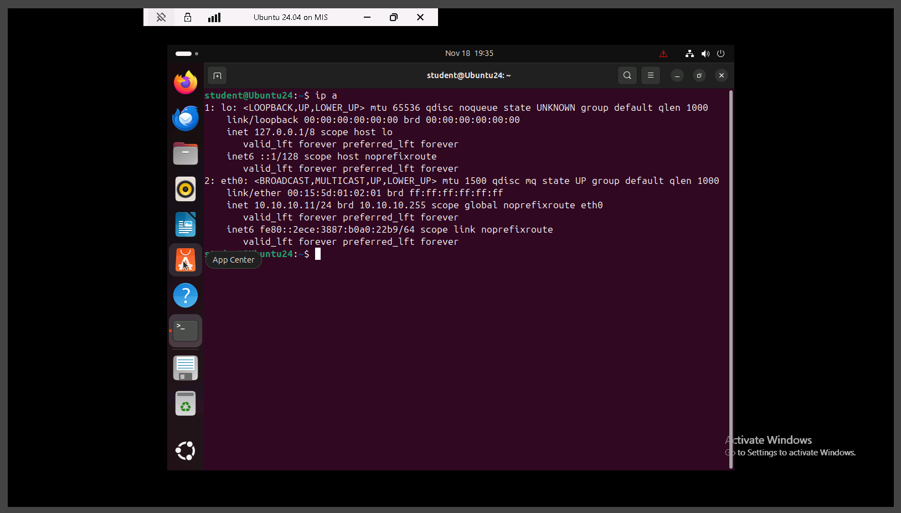
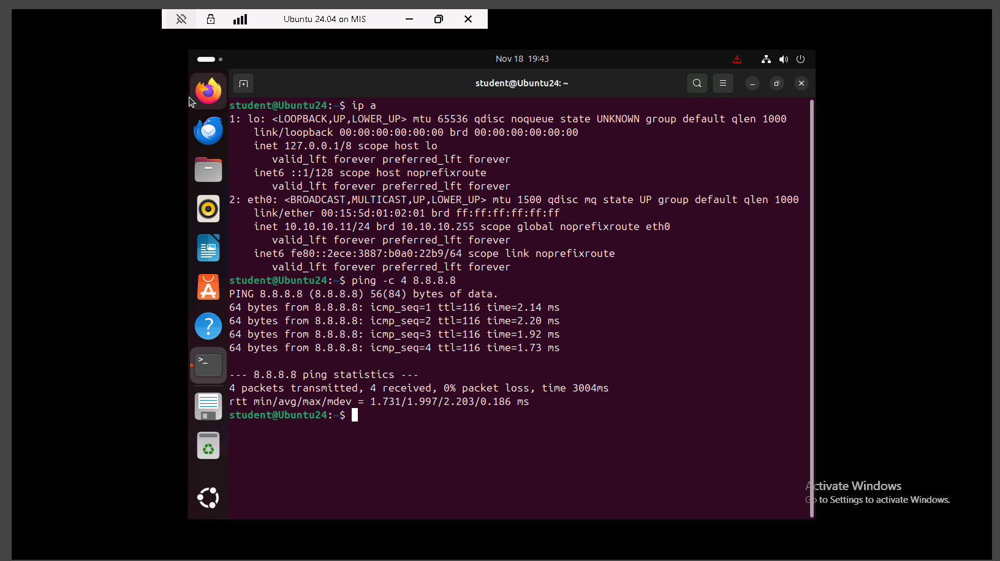
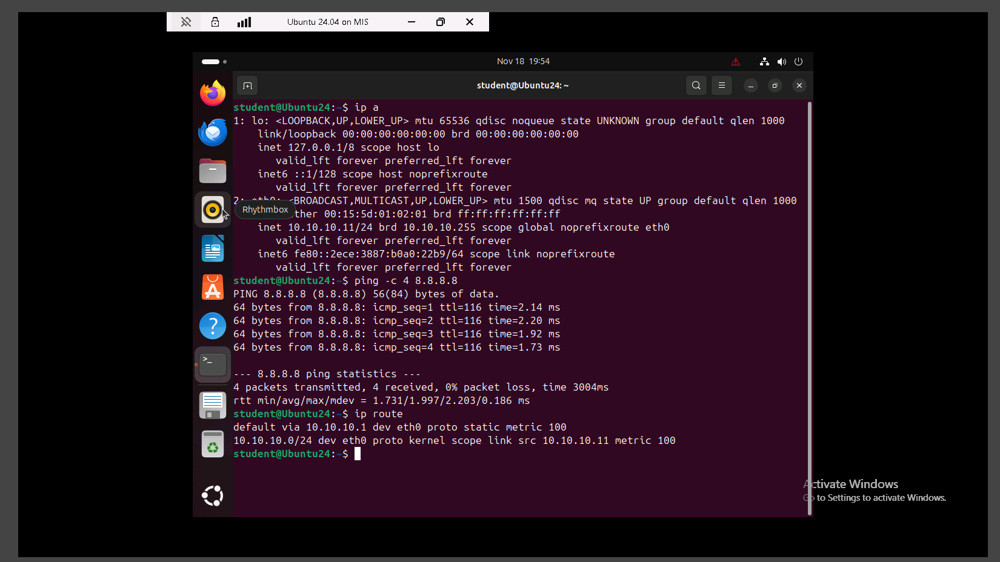
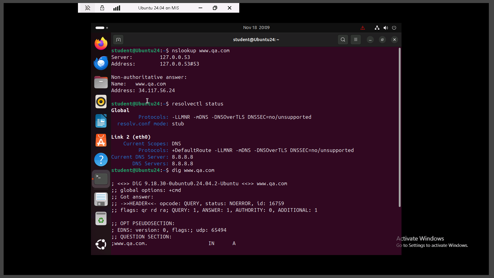

# Lab 04: Network Tools and Basic Diagnostics

**Network Applications | Solent University**

## 🎯 Objective

Learn to use Linux networking tools to examine network interfaces, test Internet connectivity, inspect routing tables and verify DNS resolution. Understand how these tools help administrators identify and troubleshoot common network problems.

## 🧪 Lab Implementation

### Step 1: Get Network Interface Information

Before troubleshooting network problems, it is important to identify the current network configuration.

**IP Address Command** `ip a` — What is my network configuration?
- The `ip a` command displays network interfaces, IP addresses, MAC addresses and interface status.
- Alternatively, use `ifconfig` if the legacy networking tools are installed.

 

**Understanding the output:**

| Component | Description |
|---|---|
| lo | Loopback interface used for internal communication. |
| eth0 / ens33 | Examples of Ethernet network interfaces. |
| inet | IPv4 address assigned to the interface. |
| inet6 | IPv6 address assigned to the interface. |
| link/ether | MAC address of the network interface. |
| UP | Indicates that the interface is administratively enabled. |
| DOWN | Indicates that the interface is administratively disabled. |

⚠️ Always verify the IP address and interface status before investigating connectivity problems.

### Step 2: Test Internet Connectivity

**Packet Internet Groper Command** `ping` — Can I reach an external network?

- The `ping` command tests network reachability using ICMP echo requests.
- Testing a public IP address allows us to examine Internet connectivity without relying on DNS resolution.

```bash
ping -c 4 8.8.8.8
```

**Understanding the command:**

- `ping` — Sends ICMP echo requests.
- `-c 4` — Limits the test to four requests.
- `8.8.8.8` — Google's public DNS server.

Without the `-c` option, Linux continues sending requests until manually stopped using Ctrl+C.

**Understanding the results:**

| Result | Description |
|---|---|
| Packets transmitted | Number of ICMP requests sent. |
| Packets received | Number of replies received. |
| 0% packet loss | All requests received a reply. |
| 100% packet loss | No replies were received. |
| time | Round-trip response time in milliseconds. |



A successful ping to `8.8.8.8` demonstrates that the Linux machine can communicate with this external IP address.

⚠️ An unsuccessful ping does not necessarily mean that Internet connectivity is unavailable. ICMP traffic may be blocked by firewall rules.

### Step 3: Check the Routing Table

**IP Routing Command** `ip route` — Where does my network traffic go?

- The `ip route` command displays the routing table.
- The routing table determines where network packets should be sent to reach their destination.

```bash
ip route
```

Alternatively, use:

```bash
netstat -rn
```

The `netstat` command requires the legacy `net-tools` package.

**Example output using ip route:**

```text
default via 10.10.10.1 dev eth0
10.10.10.0/24 dev eth0 proto kernel scope link src 10.10.10.11 
```

**Understanding the output:**

| Component | Description |
|---|---|
| default | Where to send traffic when Linux has no more specific directions. |
| via | Which gateway (router) the traffic must go through. |
| dev | Which network adapter Linux uses to send traffic. |
| 10.10.10.0/24 | The local network our computer belongs to. |
| src | The IP address Linux prefers to use when sending traffic through this route. |
| scope link | Linux can communicate with devices on this network directly, without using a router. |
| proto kernel| The route was automatically created by Linux based on the network interface configuration. |

When using `netstat -rn`, the default IPv4 route is represented by the destination `0.0.0.0` with a netmask of `0.0.0.0`.



The default gateway (router) allows the machine to communicate with destinations outside its local network.

⚠️ A missing or incorrect default route can prevent communication with external networks, even when local network communication is working.

### Step 4: Test DNS Resolution

**Name Server Lookup Command** `nslookup` — Can I resolve domain names?

- The `nslookup` command queries DNS servers to obtain DNS information.
- It helps administrators determine whether domain names can be successfully resolved into IP addresses.

```bash
nslookup www.qa.com
```

**Understanding the output:**

| Component | Description |
|---|---|
| Server | The DNS server we are asking for information. |
| Address | The IP address of the DNS server we are using. |
| Name | The domain name we are looking up. |
| Address in answer | The IP address of the domain name we searched for. |
| Non-authoritative answer | The DNS server obtained the information from another DNS server or its cache. This is normal and does not indicate an error. |

> NOTE: Unlike our Windows Server, which contacts Google's DNS server (8.8.8.8) directly, Ubuntu uses a local DNS service (127.0.0.53).
> This service checks if it already knows the IP address. If not, it asks another DNS server for the information.

To identify the configured upstream DNS servers:

```bash
resolvectl status
```

**Alternative DNS Diagnostic Command**

The `dig` command provides more detailed DNS query information.

```bash
dig www.qa.com
```



If the DNS commands are unavailable, install the DNS utilities package:

```bash
sudo apt update
sudo apt install dnsutils
```

**Why test DNS?**

If communication with an external IP address is successful but domain name resolution fails, the problem may be related to DNS configuration rather than basic network connectivity.

⚠️ Successful DNS resolution does not necessarily mean that the destination website is accessible.

## 🧰 Tools Used

- Linux Terminal (Bash Shell)
- University Learning on Demand (LOD) Platform
- Hyper-V Manager
- Linux Ubuntu 24.04

## 🔐 Security Relevance

- **Network Identification:** Examining network interfaces helps identify incorrect or unexpected network configurations.
- **Network Availability:** Connectivity testing helps detect communication failures and network service disruptions.
- **Routing Configuration:** Examining routing tables helps identify incorrect or potentially unauthorised network routes.
- **Firewall Configuration:** Firewall rules can restrict network communication, including ICMP requests.
- **DNS Security:** Verifying DNS resolution helps identify incorrect or potentially unauthorised DNS server configurations.
- **Safe Troubleshooting:** Diagnostic commands allow administrators to investigate network problems without modifying existing network configurations.

## 📌 Lessons Learned

- How to examine network interfaces using `ip a`.
- How to identify IP addresses and network interface status.
- How to test Internet connectivity using `ping`.
- How to interpret packet loss and response times.
- How to examine routing tables using `ip route` and `netstat -rn`.
- How to identify the default gateway.
- How to verify DNS resolution using `nslookup` and `dig`.
- How to identify configured DNS servers using `resolvectl status`.
- How to distinguish between connectivity, routing and DNS problems.
- The importance of network diagnostic tools in Linux administration.